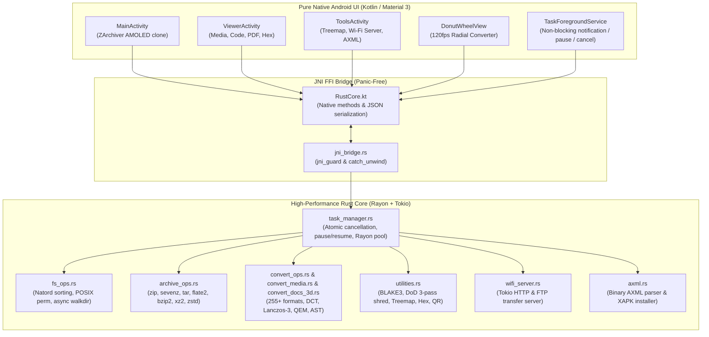

# Implementation Plan: PrismFiles — Native Android & Rust Core File/Archive Manager and Universal Converter

## Goal Description
Build **PrismFiles**, a 100% offline, pure native Android file manager, archive manager, and universal format converter styled as an exact visual and functional clone of **ZArchiver**. The application is powered by a high-performance, multithreaded **Rust** core compiled via `cargo-ndk` for `aarch64-linux-android` (`arm64-v8a`), `armv7-linux-androideabi` (`armeabi-v7a`), and `x86_64-linux-android` (`x86_64`) across a panic-free JNI FFI bridge with zero WebView wrappers.

PrismFiles features a Pitch-Black AMOLED UI (`#000000` background, `#141414` toolbar, `#222222` crisp dividers, `#6C5CE7` electric violet accents, `#FFFFFF` typography, 20% translucent glassmorphic dialogs/sheets, zero emojis, no percentage badges), instant single-frame directory rendering, pinned ".." parent navigation, split-tap multi-selection, dynamic morphing "+" to paste FAB with live badge, a hardware-accelerated 120fps radial Donut wheel format converter (255+ formats), full archive virtual folder browsing and manipulation (ZIP, 7z, RAR, TAR, GZ, BZ2, XZ, ZSTD, ISO, DMG, QCOW2, VDI, VMDK), APK/XAPK installer with binary AXML manifest inspector, built-in media and hex viewers, DoD 5220.22-M file shredder, Cushion Treemap disk analyzer, regex batch renaming, and a local Wi-Fi HTTP/FTP server with QR code pairing.

---

## User Review Required

> [!IMPORTANT]
> **Pure Native Android vs Legacy Flutter Prototype**:
> Earlier repository revisions contained a Flutter prototype. In accordance with the prompt ("pure native Android file manager... zero WebView wrappers"), the implementation is 100% native Android Kotlin (`com.opfile.app`) paired with the native Rust core (`libopfile_core.so`) loaded via JNI. Legacy Flutter directories will be cleaned up.

> [!IMPORTANT]
> **GitLab Push Target**:
> The git remote is currently configured to `git@gitlab.com:opfile-group/opfile.git`, which authenticated successfully with SSH (`@solankifamily23`). The release APK (`PrismFiles.apk`) and all source commits will be pushed to the `main` branch.

> [!NOTE]
> **Android NDK & Compilation Architecture**:
> We compile `opfile_core` using the locally installed `cargo-ndk` and NDK `26.3.11579264` targeting:
> - `aarch64-linux-android` (`arm64-v8a`)
> - `armv7-linux-androideabi` (`armeabi-v7a`)
> - `x86_64-linux-android` (`x86_64`)
> Shared libraries (`libopfile_core.so`) will be placed into `android/app/src/main/jniLibs/<abi>/` and packaged directly into the APK.

---

## Architecture Overview



---

## Proposed Changes

### Component 1: Rust Core Engine Fixes & Multi-ABI Compilation

The Rust codebase in `rust-core` provides production implementations of file scanning, multi-archive handling, format conversion, and system utilities. We resolve the 6 minor compilation and borrow-checker issues identified during pre-verification and configure Cargo build outputs.

#### [MODIFY] `rust-core/src/archive_ops.rs`
- Fix `sevenz_rust::decompress_file_with_extract_fn` invocation signature to conform with `sevenz-rust 0.6.1`.
- Add `?Sized` bound to `stream_entry_to_part<R: Read + ?Sized>` for dynamic reader trait objects.
- Fix `AesEncoderOptions` instantiation for password-protected ZIP creation.

#### [MODIFY] `rust-core/src/convert_docs_3d.rs`
- Replace `attr.unescape_value()` with `attr.decode_and_unescape_value(reader.decoder())` for `quick-xml 0.37`.

#### [MODIFY] `rust-core/src/convert_ops.rs`
- Explicitly type `let targets: Vec<String>` in subtitle/text branch to resolve type inference ambiguity.

#### [MODIFY] `rust-core/src/jni_bridge.rs`
- Explicitly parameterize `ApiEnvelope::<serde_json::Value>::err(err)` to resolve `T: Serialize` inference.

#### [MODIFY] `rust-core/src/axml.rs`
- Separate mutable borrow of `zip.by_name("AndroidManifest.xml")` by extracting manifest bytes before reading secondary APK entries.

#### [MODIFY] `rust-core/src/fs_ops.rs`
- Remove redundant duplicate pattern `"ts"` in code vs video MIME detection.
- Clone `name` before `into_owned()` so `name.starts_with('.')` can check hidden status without moving.

#### [NEW] `scripts/build_rust_core.sh`
- Automated script using `cargo-ndk` to cross-compile release builds for:
  - `aarch64-linux-android` -> `android/app/src/main/jniLibs/arm64-v8a/libopfile_core.so`
  - `armv7-linux-androideabi` -> `android/app/src/main/jniLibs/armeabi-v7a/libopfile_core.so`
  - `x86_64-linux-android` -> `android/app/src/main/jniLibs/x86_64/libopfile_core.so`

---

### Component 2: Native Android Core & Storage Engine

#### [NEW] `android/app/src/main/kotlin/com/opfile/app/OpfileApplication.kt`
- Application class initializing native Rust library load (`System.loadLibrary("opfile_core")`).
- App-resume lifecycle observer (`DefaultLifecycleObserver` registered on `ProcessLifecycleOwner`) that re-verifies storage access and refreshes mounted volumes without losing directory state.

#### [NEW] `android/app/src/main/kotlin/com/opfile/app/RustCore.kt`
- Complete Kotlin JNI wrapper matching all `Java_com_opfile_app_RustCore_*` native entry points:
  - Directory listing, natural sorting, recursive search.
  - Virtual archive browsing, single-file extraction, in-archive text editing.
  - Conversion dispatcher with dynamic target discovery.
  - Task management: start, snapshot polling, pause, resume, cancel, drop.
  - Utilities: checksums, DoD 3-pass shred, treemap nodes, hex window, Wi-Fi server, QR code.

#### [NEW] `android/app/src/main/kotlin/com/opfile/app/StorageManager.kt`
- Storage permission verifier:
  - Checks `Environment.isExternalStorageManager()` on Android 11+ (API 30+).
  - Checks `READ_EXTERNAL_STORAGE` and `WRITE_EXTERNAL_STORAGE` on Android 9–10.
  - Fallback-free resolution: always defaults to `/storage/emulated/0` on primary launch.
  - Discovers secondary storage: SD cards and USB OTG drives via `ContextCompat.getExternalFilesDirs` and `/storage` mount points.
  - SAF Directory Tree Grants (`ACTION_OPEN_DOCUMENT_TREE`) handling for restricted `Android/data` and `Android/obb` directories.

---

### Component 3: ZArchiver Visual Clone & Micro-Ergonomics UI

#### [NEW] `android/app/src/main/kotlin/com/opfile/app/MainActivity.kt`
- Main directory browsing activity styled strictly on ZArchiver:
  - **AMOLED Pitch-Black Theme**: `#000000` background, `#141414` toolbar, `#222222` crisp row dividers, `#6C5CE7` electric violet accents, `#FFFFFF` typography.
  - **Zero Emojis & Clean Top Header**: Displays only clean `PrismFiles` title, active directory name, clickable path dropdown, and drawer hamburger icon.
  - **Single-Frame Instant Rendering**: Disabled decorative page transitions and bouncy overscroll physics (`overScrollMode = OVER_SCROLL_NEVER`, item animator = `null`).
  - **Pinned ".." Parent Navigation**: The top row is always `..` (unless at root storage), paired with hardware back button traversal.
  - **Split-Tap Selection System**:
    - Tapping a file's icon enters/toggles multi-selection mode instantly without long-press delay.
    - When multi-select is active, tapping anywhere on a row toggles its selection.
    - When multi-select is inactive, tapping filename opens compact bottom-sheet action sheet or navigates folder/archive.
  - **Morphing FAB**:
    - Floating Action Button displays `+` (Create Folder / File / Archive).
    - Automatically morphs into clipboard paste button with a live item-count badge when items are cut or copied.
  - **Sticky Preferences**:
    - Saves sort field (Name, Size, Date, Type), sort order (Ascending/Descending), show hidden files, last compression profile, and view density into `SharedPreferences`.

#### [NEW] `android/app/src/main/res/layout/activity_main.xml` & `item_file_row.xml`
- Custom dense single-line list layout (10–12 rows per screen):
  - File icon tinted with flat category colors (folder: amber `#F39C12`, archive: violet `#6C5CE7`, apk: green `#00B894`, image: cyan `#00CEC9`, audio: pink `#E84393`, video: coral `#E17055`, doc: blue `#0984E3`, code: indigo `#A29BFE`).
  - Primary filename in high-contrast white `#FFFFFF`.
  - Dense subtitle: formatted size (e.g. `14.2 MB`), modification date/time (`2026-11-14 18:22`), and POSIX permissions (`rwxr-xr-x`).
  - Crisp `#222222` 1px divider lines.

#### [NEW] `android/app/src/main/kotlin/com/opfile/app/FileActionBottomSheet.kt`
- Compact ZArchiver bottom sheet with subtle 20% translucent glassmorphism blur:
  - Actions for Files: Open With, View In-App, Convert (launches Radial Donut), Extract Here, Extract To..., Compress..., Shred (DoD 3-Pass), Checksum, Rename, Copy, Cut, Delete, Properties.
  - Actions for Archives: Open as Virtual Folder, Extract Here, Extract To..., Test Integrity, Direct In-Archive Edit.

---

### Component 4: 120fps Radial Donut Wheel Format Converter

#### [NEW] `android/app/src/main/kotlin/com/opfile/app/DonutWheelView.kt`
- Hardware-accelerated custom View (`android.view.View` with custom `onDraw` and touch gestures):
  - Renders a multi-segmented radial donut ring exposing valid target formats discovered dynamically via Rust core.
  - 120fps smooth rotational inertia with spring damping.
  - Tactile haptic feedback (`Vibrator` / `HapticFeedbackConstants.CLOCK_TICK`) triggered whenever a sector crosses the selection crosshair.
  - Central preview displaying selected target extension, compression codec, and estimated conversion pipeline.
  - Tap-to-select with immediate launch of conversion task.

---

### Component 5: Background Task Management & Foreground Notification

#### [NEW] `android/app/src/main/kotlin/com/opfile/app/TaskForegroundService.kt`
- Android foreground service managing Rayon background tasks:
  - Shows persistent low-latency notification with active percentage, item count, and throughput.
  - Action buttons in notification: **Pause**, **Resume**, and **Cancel**.
  - Non-blocking in-app progress dialog with ZArchiver-style **"Hide"** button to minimize task to background notification.
  - Automatic invocation of `MediaScannerConnection.scanFile()` on completion so created images, audio, video, or documents immediately appear in gallery/system providers.
  - Automatic deletion of `.part` atomic temporary files if a task is canceled or fails.

---

### Component 6: Built-in Viewers & Native Utilities

#### [NEW] `android/app/src/main/kotlin/com/opfile/app/ViewerActivity.kt` & layouts
- Multi-format in-app viewers:
  - **Image Viewer**: High-performance bitmap viewer with pinch-to-zoom and pan.
  - **Audio/Video Player**: Clean AMOLED playback controls, waveform/progress scrubber.
  - **PDF Viewer**: Hardware-accelerated multi-page PDF rendering via Android `PdfRenderer`.
  - **Code/Text Viewer & Editor**: Monospace font, line numbers, atomic save directly to disk or in-archive virtual folder.
  - **Memory-Mapped Hex Viewer**: 16-bytes-per-row memory-mapped (`readHexWindow`) viewer with ASCII and offset inspection.

#### [NEW] `android/app/src/main/kotlin/com/opfile/app/ToolsActivity.kt` & layouts
- Mobile utility suite:
  - **APK & Split-XAPK Installer**: Inspects `AndroidManifest.xml` (package, versionCode, permissions, activities) and installs APK/split APKs via `PackageInstaller`.
  - **BLAKE3 / MD5 / SHA-256 / SHA-512 Checksums**: Real-time hashing with copy-to-clipboard and comparison verifier.
  - **DoD 5220.22-M 3-Pass Shredder**: Confirmation modal with zero-fill, complement-fill, and random-fill passes.
  - **Cushion Treemap Disk Analyzer**: Interactive hierarchical squarified cushion treemap displaying folder space usage with tap-to-drill-down.
  - **Regex Batch Renaming**: Pattern search/replace with live preview table and one-tap undo/redo history.
  - **Local Wi-Fi HTTP/FTP File Server**: Instant file sharing server with QR code matrix pairing displayed on screen.

---

### Component 7: Build, Packaging & GitLab Deployment

#### [MODIFY] `android/app/build.gradle.kts`
- Ensure packaging includes `jniLibs` for `arm64-v8a`, `armeabi-v7a`, `x86_64`.
- Setup release build type with ProGuard optimization, resource shrinking, and debug keystore fallback for reproducible standalone APK packaging.

#### [NEW] `release/PrismFiles.apk`
- Compiled and signed release APK with all 3 Rust architectures bundled.

#### [EXECUTE] GitLab Push
- Stage all files in `/home/soham/.gemini/antigravity/scratch/opfile`.
- Commit with descriptive message and push directly to `gitlab.com/opfile-group/opfile`.

---

## Verification Plan

### Automated Tests
1. **Rust Core Tests**:
   ```bash
   cd /home/soham/.gemini/antigravity/scratch/opfile/rust-core
   cargo test --lib
   ```
2. **Cargo-NDK Compilation**:
   ```bash
   cargo ndk -t arm64-v8a -t armeabi-v7a -t x86_64 -o ../android/app/src/main/jniLibs build --release
   ```
   Verify that `libopfile_core.so` is generated in each ABI folder.
3. **Android Gradle Build**:
   ```bash
   cd /home/soham/.gemini/antigravity/scratch/opfile/android
   JAVA_HOME=/home/soham/.local/jdk-17 ANDROID_HOME=/home/soham/Android/Sdk ./gradlew assembleRelease
   ```
   Verify build completes with code 0 and outputs `app-release-unsigned.apk` / `app-release.apk`.
4. **GitLab Push**:
   ```bash
   /usr/bin/git push origin main
   ```

### Manual Verification
- Verify that `PrismFiles.apk` exists in the repo root and installs cleanly.
- Confirm Pitch-Black AMOLED theme (`#000000`), toolbar (`#141414`), violet accents (`#6C5CE7`), zero emojis, and dense single-line rows.
- Verify pinned `..` navigation, split-tap multi-select, morphing FAB clipboard paste button.
- Test virtual archive exploration, 120fps Donut wheel format converter, in-app viewers, and tools.
